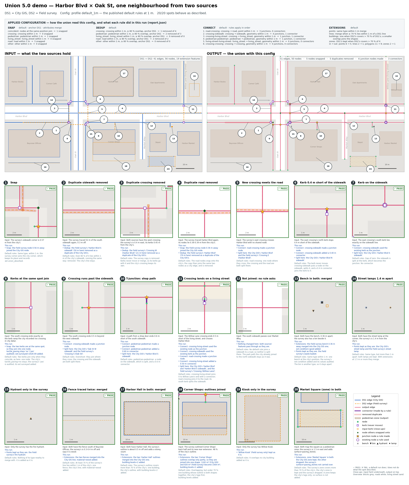

# The demo: one neighbourhood, two sources, your config

The harness cases test one behaviour each, in its own small box. The demo shows
them working together: one realistic street corner described by two sources,
and one picture of what the union makes of it under the config you give it.
Use it to show someone what the union does, to see what a config from the
configurator would do before running it on real data, or as a starting point
for your own example.

## Try a config

1. Open `docs/union-configurator.html`, set it up, press **Copy configuration**.
2. Paste it into `demo/input.json`, replacing the value of `"config"` (or the
   whole file).
3. Run the demo and open the picture:

```bash
./run_demo.sh local                      # demo/input.json            -> runs/demo_input/demo.png
```

`demo/input.json` ships with the published default rules at 1 m, so the first
run shows the reference behaviour. Other ways to run it:

```bash
./run_demo.sh local my_config.json       # any config file            -> runs/demo_my_config/
./run_demo.sh local demo/examples/configurator_defaults.json
                                         # the configurator, untouched (custom rules, 0.5 m)
./run_demo.sh local demo/examples/extensions_2m.json
                                         # only extensions, at 2 m: see spots 13-20 change
./run_demo.sh local default_1m           # a harness profile          -> runs/demo_default_1m/
./run_demo.sh local off                  # nothing configured, for contrast
```

The file can hold any of these. Anything else in it, such as an `"about"` note
or dataset ids, is ignored, because the demo always runs on its own two
datasets:

| Form | Example |
|---|---|
| a bare config (what **Copy configuration** gives) | `{"snap": {...}, "dedup": {...}, "connect": {...}, "extensions": {...}}` |
| a wrapper | `{"about": "...", "config": {...}}` (what `demo/input.json` ships as) |
| a whole union request body | `{"tdei_dataset_id_one": "...", "tdei_dataset_id_two": "...", "config": {...}}` |

`"config"` may also be a JSON string, as the API accepts. A missing stage is off;
`{}` turns everything off.

The union checks the config before anything is loaded. A config it rejects
stops the run with the union's own message, for example:

```
== config: demo/input.json
   the union rejects this config:
     config.snap.mode: expected one of off, default, custom, got "defualt"
```

A file that is not valid JSON says where: `demo/input.json is not valid JSON:
Expecting property name enclosed in double quotes at line 4, column 40`.

## How a run is judged

Each numbered spot has a description of what the **default rules at 1 m** do
there, plus checks that test it. How they are used depends on the config:

| The config | Each spot shows | Meaning |
|---|---|---|
| exactly the defaults at 1 m | **✓ PASS** / **✗ FAIL** | a FAIL is a bug in the union; `run_demo.sh` exits 1 |
| anything else | **= default** / **≠ default** | whether this config gives the same result there as the defaults; neither is an error |

"Exactly the defaults" compares the config as the union applied it (its
`effective_config`) with the defaults, so a pasted config that spells the
defaults out in full counts too. When comparing another config, rule names are
ignored: the configurator names its rules its own way (`connect_crossing_road`
rather than `road-crossing`), so a connector or junction made by any rule
counts.

Whatever the config, every spot also says what **this run** did there, read
from the output: which node snapped onto which and how far, which duplicate was
removed, what was split, which rule made which connector or junction node, and
which points and buildings merged. The configurator's untouched config (custom
rules, 0.5 m) gives the same result as the defaults at 18 of the 20 spots. It
differs at two: the snap at spot 1 (0.57 m apart) and the T-junction at spot 10
(0.6 m short) are both beyond 0.5 m.

## The picture (`runs/demo_<name>/demo.png`)



- **Applied configuration**, at the top: each stage (snap, dedup, connect,
  extensions) as the union applied it, every rule with its settings, and what
  it did in this run. For example, `crossing-sidewalk: crossing → sidewalk,
  geometry within 1 m → 4 junctions, 1 connector`. The union's warnings are
  listed under it.
- **The whole scene twice**, drawn like a street map (blocks grey, roads white,
  the living street sand-coloured).
  - Left is the input: DS1 in blue, DS2 in orange dashes.
  - Right is the output: edges in pink, nodes as green dots, kerbs as purple
    squares, connectors in purple, removed duplicates as a faint red band.
- **A close-up of each numbered spot**: the input faint underneath, the output
  on top, and the status in the corner. Under each close-up:
  - **Input**: what the sources hold there.
  - **This run**: what this config did there.
  - **Default rules**: what the defaults do, to compare.

  Most of the action is under a metre, invisible at full scale, which is why
  the close-ups are there.

Reference copies in `docs/images/`:

| Image | Config |
|---|---|
| `demo_default_1m.png` | the defaults at 1 m (what `demo/input.json` ships with): 20 PASS |
| `demo_configurator_defaults.png` | the configurator, untouched: 18 = default, 2 ≠ default |
| `demo_off.png` | nothing configured: every duplicate stays and every gap stays open |

`run_config.json` in the run folder records the config as given, as the union
applied it, and the defaults it was compared with. `demo_results.geojson` holds
each spot's status and text (for QGIS).

## The scene

Harbor Blvd (`highway=secondary`, east–west) crosses Oak St
(`highway=residential`, north–south). The rest of the corner:

- **Sidewalks** run along both sides of both streets, 10 m from Harbor Blvd's
  centre and 8 m from Oak St's, meeting at the four corners.
- **Crossings** cross all four arms of the intersection, kerb to kerb.
- **Market Alley** (`highway=service`) leaves Harbor Blvd to the south.
- **Willow Lane** (`highway=living_street`), a shared street closed to traffic
  at Harbor Blvd, runs north.
- **Extension features:** buildings, a market square (a pedestrian zone), a
  bus stop with a bench, street lamps, a fence and a hydrant.

Two sources describe it:

| | Holds |
|---|---|
| **DS1 — City GIS** | roads, every sidewalk, two of the four crossings (west and north) with their kerbs, Willow Lane, a park path, a bus stop path, a kerb ramp on Oak St with no crossing yet; eight buildings, Market Square, a bench, a street lamp, a fence |
| **DS2 — Field survey** | all four crossings with kerbs (the west one duplicates the city's), part of the south sidewalk and part of Harbor Blvd traced again a few decimetres off, a path from a shop door; the bench again with its condition, a bin, a hydrant, the street lamp 1.4 m off, the fence again (wood), Harbor Hall again with its storey count, Corner Shops' back half with a new rear extension, a new kiosk, Market Square again 1.5 m east |

## What the default rules do, spot by spot

The numbers match the picture.

| # | Spot | The sources | The union (default rules, 1 m) |
|---|---|---|---|
| 1 | Snap | survey sidewalk corner 0.57 m from the city's | joins the city corner, which records `ext:union_absorbed` |
| 2 | Duplicate sidewalk | 52 m of sidewalk traced again, 0.3 m off | removed: over 80 % lies within 1 m of the city's, running the same way |
| 3 | Duplicate crossing | both have the west crossing, 0.4 m apart; kerbs 0.45 m apart | survey copy removed with its kerbs; kerbs never move or merge |
| 4 | Duplicate road | Harbor Blvd traced again, nodes 0.36–0.39 m off | road nodes snap, then the copy joins the same two nodes as a city edge: removed |
| 5 | Crossing meets road | new crossing crosses Harbor Blvd, no shared node | `road-crossing`: one node where they cross, both split |
| 6 | Kerb short of sidewalk | crossing's kerb 0.4 m short of the sidewalk | `crossing-sidewalk`: node on the sidewalk, split, 0.4 m connector; the kerb stays |
| 7 | Kerb on sidewalk | crossing's kerb exactly on the sidewalk line | gap of zero: sidewalk split at the kerb, no connector |
| 8 | Same-spot kerbs | crossing ends exactly on the city's kerb ramp | coincident kerbs join; city `tactile_paving=no` stays, survey's `yes` audited |
| 9 | Overshoot | crossing ends 0.5 m beyond the sidewalk | they join where they cross; both split |
| 10 | T-junction | shop path ends 0.6 m short of the sidewalk | `pedestrian-pedestrian`: node on the sidewalk, split, 0.6 m connector |
| 11 | Living street | crossing ends 0.5 m short of Willow Lane, and crosses Harbor Blvd | `crossing-living-street` connector to Willow Lane's end; `road-crossing` node on the road; its south kerb splits the sidewalk |
| 12 | Not joined | sidewalk passes over Market Alley | no rule joins a sidewalk to a road: untouched. The city's own park-path junction stays as it was |
| 13 | Point in both | the bench in both, 0.36 m apart; a survey bin beside it | one bench at the city's position, `ext:condition` added and audited; the bin is another type, kept apart |
| 14 | Points too far apart | the street lamp in both, 1.4 m apart | both kept; with extensions at 1.5 m or more they merge |
| 15 | New point | a hydrant only in the survey | added as it is |
| 16 | Line in both | the fence in both, 0.3–0.4 m apart; the survey says `material=wood` | at least 70 % of the survey's line within 1 m of the city's: one fence, the city's line, `material` added |
| 17 | Building in both | Harbor Hall in both, outlines 0.5 m apart; the survey adds `building:levels` | the survey's outline covers more than 70 % of the city's: one building, the city's outline, `building:levels` added |
| 18 | Building partly overlapping | the survey outlines Corner Shops' back half and its rear extension (48 % of the city's outline) | under 70 %: one building whose outline is both shapes together, city tags first, `building:levels` added |
| 19 | New building | Willow Kiosk only in the survey | added as it is |
| 20 | Zone in both | Market Square in both, the survey's 1.5 m east with `surface=paving_stones` | the survey's zone covers more than 70 % of the city's: the city's zone kept, the survey's dropped. Zones keep the city's tags only, so `surface` is not added |

## The raw files

`demo/data/` holds what a TDEI upload would hold: the OSW 0.3 GeoJSON files for
each source, one feature per line.
- `ds1_nodes`, `ds1_edges`, `ds1_zones`, `ds1_points`, `ds1_lines` and
  `ds1_polygons` hold DS1, the City GIS.
- `ds2_*.geojson`, the same six files, hold DS2, the Field survey.
- `scenarios.geojson` holds the numbered spots and their explanations.

They are loaded as datasets `demo-ds1` / `demo-ds2`: any rows under those ids
are replaced and nothing else is touched. To show one behaviour on its own,
copy the few features of that spot (and their nodes) into a new pair of files.
Or upload `demo/data` through TDEI as two datasets and run the real job on them
with the same config. The coordinates are near Albany, Oregon, about 500 m
east of the harness test grid.

## Changing the scene

The scene is written in `demo/scene.py`, in metres around the intersection.
- edges with their names and tags;
- tagged nodes (kerbs);
- extension features (points, lines, buildings) and zones;
- the numbered spots: their text, their checks, and their `look` boxes.

The `look` boxes are where "This run" looks: anything that happens inside them
(a node snapped, the middle of a removed or reshaped edge, a split point, the
middle of a connector, a junction node, a point, the middle of a line, a
building's or zone's centre) is reported for that spot.

After editing the scene:

```bash
BUILD=1 ./run_demo.sh local      # rebuild demo/data from scene.py, then run
```

The checks use the vocabulary described in `scene.py`, for example
`("connector", (x, y), rule)` or `("node", (x, y), {key: value})`.
`demo/check_demo.py` runs them.

| File | Purpose |
|---|---|
| `run_demo.sh` | the one command: read the config, have the union validate it, load `demo/data` as `demo-ds1` / `demo-ds2`, union, export, check, draw |
| `demo/input.json` | the config the demo runs with by default: paste yours here |
| `demo/examples/` | example configs (`configurator_defaults.json`: the configurator, untouched) |
| `demo/read_input.py` | finds the config in an input file (bare, wrapper or request body) |
| `demo/scene.py` | the scene and the numbered spots (the single source of truth) |
| `demo/build_demo.py` | writes and validates `demo/data/*.geojson` from the scene |
| `demo/describe.py` | says in words what a run did: the applied config per rule, and each spot |
| `demo/check_demo.py` | statuses per spot, prints the run's story; writes `demo_results.geojson` |
| `demo/demo_sheet.py` | draws `demo.png` |
| `qgis/load_demo.py` | loads the demo inputs and every run into QGIS (Plugins ▸ Python Console ▸ Show Editor ▸ Run) |
