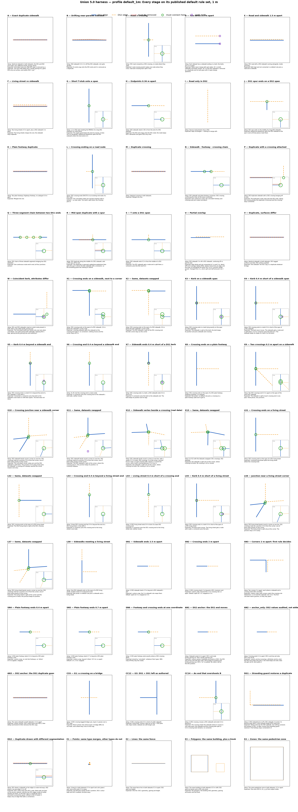

# Test dataset

Synthetic but schema-valid OSW data built to exercise `content.tdei_union_dataset` 5.0, with one small case per behaviour. **Generated**: the data by `harness/generate_dataset.py`, this page by `harness/case_docs.py` (both from `harness/cases.py`). Do not edit either by hand.

| File | Contents |
|---|---|
| `data/ds1_*.geojson` | Dataset 1: nodes, edges, zones, extension points / lines / polygons |
| `data/ds2_*.geojson` | Dataset 2: the same six files |
| `data/expected/*.geojson` | reference layers built from the case catalogue, one feature per case and profile: case areas, must-connect points, must-be-removed edges |

- **Location:** Albany, Oregon, around `-123.10, 44.63`; each case sits in its own area of the map.
- **Finding a case:** every edge `name` starts with its case id (`"A: duplicate sidewalk"`); zones and extension features carry `ext:case`.
- **Ids** are numeric (TDEI stores `_id` as `bigint`). DS1 starts at nodes `1000001`, edges `1500001`, zones `1700001`, points `1800001`, lines `1850001`, polygons `1900001`; DS2 the same with a leading 2.
- **Profiles:** a case is checked only under the profiles listed for it ([profiles.md](profiles.md)); "default" means both `default_1m` and `default_3m`.

Reference sheets (inputs and what each profile expects, one panel per case): [off](images/reference_off.png), [default_1m](images/reference_default_1m.png), [default_3m](images/reference_default_3m.png), [custom_snap](images/reference_custom_snap.png), [custom_anchor](images/reference_custom_anchor.png), [connect_only](images/reference_connect_only.png), [custom_extensions](images/reference_custom_extensions.png), [ext_lines_polygons](images/reference_ext_lines_polygons.png), [ext_points_zones](images/reference_ext_points_zones.png), [custom_connect](images/reference_custom_connect.png).

## Network cases (A–W)

Carried over from 4.x. Their expectations are now those of the `default` rule sets.

| Case | Setup | Expected | Checked under |
|---|---|---|---|
| **A** Exact duplicate sidewalk | Identical sidewalk in both datasets; the DS1 and DS2 end nodes carry different tactile_paving values. | Coincident ends join; the DS2 copy is removed as a duplicate. The end node keeps DS1's tactile_paving=no, gains DS2-only ext:surface, and audits DS2's 'yes'. | default (1 m, 3 m), `off`, `connect_only` |
| **B** Drifting near-parallel sidewalk | DS2 sidewalk 0.4-1.2 m off the DS1 sidewalk, not quite parallel. | Its ends snap onto the DS1 ends and it is removed as a duplicate. | default (1 m, 3 m) |
| **C** Road x crossing | DS1 road crossed by a DS2 crossing, no node where they meet. | road-crossing (point) makes one node where they cross; road and crossing each split in two. | default (1 m, 3 m) |
| **D** Two kerbs 2.5 m apart | Each dataset has a sidewalk ending in a kerb; the kerbs are 2.5 m apart. | Kerbs never merge with each other. At 1 m both sidewalks and kerbs remain. At 3 m the DS2 sidewalk is removed as a duplicate and its kerb goes with it (open design question). | default (1 m, 3 m) |
| **E** Road and sidewalk 1.5 m apart | DS1 road with a DS2 sidewalk running alongside, inside proximity. | Both kept and not connected: no default rule joins a road and a sidewalk. | default (1 m, 3 m) |
| **F** Living street vs sidewalk | Two living streets 0.5 m apart, plus a DS2 sidewalk 3 m away. | The living streets merge into one; the sidewalk stays separate. | default (1 m, 3 m) |
| **G** Short T-stub onto a span | 1.2 m DS2 stub meeting the MIDDLE of a long DS1 sidewalk (no node there). | The angle guard keeps the stub (it crosses, it does not run alongside). pedestrian-pedestrian splits the DS1 sidewalk where the stub ends on it. | default (1 m, 3 m) |
| **H** Endpoints 0.36 m apart | DS2 sidewalk starts 0.36 m from the end of a DS1 sidewalk. | The DS2 end snaps onto the DS1 node; the node keeps DS1's attributes and gains DS2-only ones. | default (1 m, 3 m) |
| **I** Road only in DS2 | Service road present only in DS2. | Kept unchanged — nothing to merge with. | default (1 m, 3 m) |
| **J** DS1 spur ends on a DS2 span | DS1 spur ends on the middle of a long DS2 sidewalk. | pedestrian-pedestrian splits the DS2 sidewalk at the spur's end; all three pieces meet there. | default (1 m, 3 m) |
| **K** Plain footway duplicate | Two plain footways (highway=footway, no subtype) 0.4 m apart. | Merged into one. | default (1 m, 3 m) |
| **L** Crossing ending on a road node | DS2 crossing ends EXACTLY on an existing mid node of a DS1 road. | The coincident nodes join and the existing node is reused — no new node. The road is split there; the crossing joins it. | default (1 m, 3 m) |
| **M** Duplicate crossing | Identical crossing in both datasets. | Merged into one. | default (1 m, 3 m) |
| **N** Sidewalk - footway - crossing chain | DS1 sidewalk and plain-footway connector; DS2 crossing continuing the chain at the same coordinate. | One continuous route: the coincident footway and crossing ends join (snap coincident). | default (1 m, 3 m), `off` |
| **P** Duplicate with a crossing attached | DS2 duplicate sidewalk with a DS2 crossing hanging off its end. | The duplicate's ends snap onto the DS1 ends, taking the crossing along; the duplicate is removed and the crossing stays connected. | default (1 m, 3 m) |
| **Q** Three-segment chain between two DS1 ends | DS2 chain of three sidewalk segments bridging two DS1 sidewalks. | One continuous route end to end; all four junctions connect. | default (1 m, 3 m) |
| **R** Mid-span duplicate with a spur | DS2 duplicate along the middle of a DS1 sidewalk, with a DS2 spur off its end. | The duplicate is removed; pedestrian-pedestrian then joins the spur's end to the DS1 sidewalk with a connector, so the stranding guard has nothing to restore. | default (1 m, 3 m) |
| **S** T onto a DS1 span | DS2 sidewalk ends 0.2 m from the middle of a DS1 sidewalk. | The DS1 sidewalk gets a node and is split there; a connector joins the DS2 end to it. | default (1 m, 3 m) |
| **U** Partial overlap | DS2 sidewalk 2 m off a DS1 sidewalk, continuing 45 m past its end. | Kept whole and not connected at 1 m and 3 m: about 52% of it overlaps (below 80%), dedup never trims an edge, and the ends run alongside the other line, so no T junction (angle guard). Changed from 4.x, which split and half-removed it at 3 m. | default (1 m, 3 m) |
| **V** Duplicate, surfaces differ | Identical sidewalk in both datasets; DS1 tagged surface=concrete, DS2 surface=asphalt. | One sidewalk: the DS2 copy is a duplicate whatever its tags. | default (1 m, 3 m) |
| **W** Coincident kerb, attributes differ | DS1 and DS2 sidewalks meet at a kerb node present in both; DS2's copy adds tactile_paving=yes. | The coincident kerbs join (kerbs only ever join when coincident): one node joining both sidewalks, keeping DS1's tags, gaining tactile_paving=yes and auditing it. | default (1 m, 3 m), `off` |

## Crossing ↔ sidewalk (X)

"Sidewalk" means `highway=footway` + `footway=sidewalk`. Every sidewalk is drawn north–south, so a crossing end with the same x lies exactly on the sidewalk line.

| Case | Setup | Expected | Checked under |
|---|---|---|---|
| **X1** Crossing ends on a sidewalk, next to a corner | DS2 crossing ends on the span of a DS1 sidewalk, 0.6 m below the sidewalk's corner node. | crossing-sidewalk splits the sidewalk at the crossing end (gap 0, no connector); nothing moves and the corner stays as it is. | default (1 m, 3 m) |
| **X2** Same, datasets swapped | DS1 crossing ends on the span of a DS2 sidewalk, 0.6 m below the DS2 sidewalk's corner node. | The DS2 sidewalk is split at the DS1 crossing end; the DS2 corner stays as the corner. | default (1 m, 3 m) |
| **X3** Kerb on a sidewalk span | DS2 crossing ends in a kerb lying exactly on the span of a DS1 sidewalk. | The sidewalk is split at the kerb; the kerb keeps its position and joins sidewalk and crossing. | default (1 m, 3 m), `connect_only` |
| **X4** Kerb 0.4 m short of a sidewalk span | DS2 crossing ends in a kerb 0.4 m short of the span of a DS1 sidewalk. | The kerb never moves. The sidewalk gets a node and is split there; a 0.4 m connector joins the kerb to it. The sidewalk keeps its shape (4.x bent it to the kerb). | default (1 m, 3 m), `connect_only` |
| **X5** Kerb 0.4 m beyond a sidewalk end | DS2 crossing ends in a kerb 0.4 m beyond the end of a DS1 sidewalk, in line with it. | Connected: a connector joins the kerb to the sidewalk's end node (4.x left them apart). The kerb does not move. | default (1 m, 3 m) |
| **X6** Crossing end 0.4 m beyond a sidewalk end | As X5, but the crossing end is a bare node. | A connector joins the crossing end to the sidewalk's end node; neither moves. | default (1 m, 3 m) |
| **X7** Sidewalk ends 0.4 m short of a DS1 kerb | DS1 crossing ends in a kerb; a DS2 sidewalk ends 0.4 m short of it. | A connector joins the kerb to the sidewalk end. The kerb keeps its position and its tags. | default (1 m, 3 m) |
| **X8** Crossing ends on a plain footway | DS2 crossing ends on the span of a DS1 plain footway (highway=footway, no subtype). | Not joined: no default rule joins a crossing to a plain footway (add one to get it). | default (1 m, 3 m) |
| **X9** Two crossings 0.3 m apart on a sidewalk | Two DS2 crossings end 0.3 m apart on the span of the same DS1 sidewalk. | The sidewalk is split at each crossing end in one pass: three pieces, two junctions. | default (1 m, 3 m) |
| **X10** Crossing junction near a sidewalk corner | DS2 sidewalk bends round a corner as one line. DS1 crossings meet at a junction 2.6 m from the corner; one of them ends exactly on the corner. | The coincident corner nodes join and the DS2 sidewalk is split there. The junction 2.6 m away never joins the sidewalk: a crossing at it already reaches the corner (nearer end only). | default (1 m, 3 m) |
| **X11** Same, datasets swapped | DS1 sidewalk bends round a corner as one line. DS2 crossings meet at a junction 2.6 m from the corner; one of them ends exactly on the corner. | The DS1 sidewalk is split at the corner, where the crossing joins it. The junction keeps its position; no crossing collapses. | default (1 m, 3 m) |
| **X12** Sidewalk vertex beside a crossing (real data) | DS1 sidewalk bends round a corner as one line, with a vertex S 2.3 m west. DS2 crossings: A on the corner, junction B 0.6 m east, an east crossing with a bend 2.7 m from the corner, and a south crossing passing 2.3 m from S. | The sidewalk is split only at the corner, where crossing A-B ends. No crossing is cut or moved. | default (1 m, 3 m) |
| **X13** Same, datasets swapped | As X12 with the datasets swapped: DS1 crossings, DS2 sidewalk. | The sidewalk is split only at the corner, where crossing A-B ends. No crossing is cut or moved. | default (1 m, 3 m) |

## Crossing ↔ living street (LS)

A living street (`highway=living_street`) is a landing way for crossings, like a sidewalk, but never joins a sidewalk, footway or road.

| Case | Setup | Expected | Checked under |
|---|---|---|---|
| **LS1** Crossing ends on a living street | DS2 crossing ends on the span of a DS1 living street. | crossing-living-street splits the living street where the crossing ends. | default (1 m, 3 m) |
| **LS2** Same, datasets swapped | DS1 crossing ends on the span of a DS2 living street. | The DS2 living street is split at the DS1 crossing end. | default (1 m, 3 m) |
| **LS3** Crossing end 0.4 m beyond a living street end | A bare DS2 crossing end lies 0.4 m beyond the end of a DS1 living street, in line with it. | A connector joins the crossing end to the living street's end node. | default (1 m, 3 m) |
| **LS4** Living street 0.4 m short of a crossing end | A DS2 living street ends 0.4 m short of a bare DS1 crossing end. | A connector joins the DS1 crossing end to the living street end; neither moves. | default (1 m, 3 m) |
| **LS5** Kerb 0.4 m short of a living street | DS2 crossing ends in a kerb 0.4 m short of the span of a DS1 living street. | The kerb never moves. The living street gets a node and is split; a connector joins the kerb. | default (1 m, 3 m) |
| **LS6** Junction near a living street corner | DS2 living street bends round a corner as one line. DS1 crossings meet at a junction 2.6 m from the corner; one of them ends exactly on the corner. | The living street is split only at the corner. The junction stays 2.6 m away. | default (1 m, 3 m) |
| **LS7** Same, datasets swapped | DS1 living street bends round a corner as one line. DS2 crossings meet at a junction 2.6 m from the corner; one of them ends exactly on the corner. | The living street is split at the corner and the crossing joins it there; the junction keeps its position. | default (1 m, 3 m) |
| **LS8** Sidewalks meeting a living street | One DS2 sidewalk ends on the span of a DS1 living street; another ends 0.4 m beyond its end. | Not joined: no default rule joins a sidewalk and a living street. | default (1 m, 3 m) |

## Per-type snap distances (SN)

Mostly checked under `custom_snap`.

| Case | Setup | Expected | Checked under |
|---|---|---|---|
| **SN1** Sidewalk ends 2.5 m apart | A DS2 sidewalk starts 2.5 m beyond a DS1 sidewalk's end. | custom_snap: the 3 m sidewalk rule snaps them. Default: apart at 1 m, snapped at 3 m. | `custom_snap`, `default_1m`, `default_3m` |
| **SN2** Crossing ends 2 m apart | A DS2 crossing starts 2 m beyond a DS1 crossing's end. | custom_snap: beyond the 1.5 m crossing rule, so apart. Default: apart at 1 m, snapped at 3 m. | `custom_snap`, `default_1m`, `default_3m` |
| **SN3** Corners 2 m apart: first rule decides | Two corners 2 m apart, each where a sidewalk and a crossing meet (DS1 and DS2). | custom_snap: both corners match the crossing rule (listed first, 1.5 m) and the sidewalk rule (3 m). The first rule both match governs, so they stay apart. | `custom_snap`, `default_1m` |
| **SN4** Plain footway ends 0.4 m apart | A DS2 plain footway starts 0.4 m beyond a DS1 plain footway's end. | custom_snap: no rule lists footways, so 'others' (0.5 m) applies: snapped. | `custom_snap`, default (1 m, 3 m) |
| **SN5** Plain footway ends 0.7 m apart | A DS2 plain footway starts 0.7 m beyond a DS1 plain footway's end. | custom_snap: beyond 'others' (0.5 m), so apart. Default (1 m, 3 m): snapped. | `custom_snap`, default (1 m, 3 m) |
| **SN6** Footway and crossing ends at one coordinate | A DS1 plain footway ends exactly where a DS2 crossing starts. | Joined by 'coincident', whatever their types. With snap off they stay two nodes. | `custom_snap`, default (1 m, 3 m), `off`, `connect_only` |

## Anchors and attributes (AN)

Checked under `custom_anchor` (DS2 anchored for sidewalks).

| Case | Setup | Expected | Checked under |
|---|---|---|---|
| **AN1** DS2 anchor: the DS1 end moves | Sidewalk ends 0.4 m apart; DS1's end node tactile_paving=no, DS2's tactile_paving=yes. | custom_anchor (sidewalks anchored on DS2): the DS1 end moves onto the DS2 node, which keeps its position and tactile_paving=yes; DS1's 'no' is audited. No node is left at the DS1 position. | `custom_anchor`, default (1 m, 3 m) |
| **AN2** anchor_only: DS2 values audited, not added | Crossing ends 0.3 m apart; DS1's end has ext:note, DS2's has ext:lit. | custom_anchor (crossings, attributes anchor_only): the DS2 end snaps onto DS1's; the node keeps ext:note, does not gain ext:lit, and audits it. | `custom_anchor`, default (1 m, 3 m) |
| **AN3** DS2 anchor: the DS1 duplicate goes | The same sidewalk in both datasets, 0.3 m apart. | custom_anchor: DS1's ends move onto DS2's, then dedup (anchored on DS2) removes the DS1 copy. | `custom_anchor`, default (1 m, 3 m) |

## Ordered connect rules with node_tags / edge_tags (CC)

Checked under `custom_connect`. The ids in titles (O1–O3, W1–W5, G1, G3) are the decided edge cases of the requirement spec; see [union-expectations.md](union-expectations.md).

| Case | Setup | Expected | Checked under |
|---|---|---|---|
| **CC1** O1: two rules match the same spot | A DS2 crossing ends 0.5 m short of a DS1 sidewalk. | kerbed-crossing (listed first) takes it: a node on the sidewalk with its node_tags (barrier=kerb, kerb=lowered, ext:survey_batch) and a connector with its edge_tags (crossing:markings=zebra, surface=asphalt, ext:verified). Neither set reaches the other. The broader footway-sidewalk rule skips it. | `custom_connect` |
| **CC2** The broader rule catches a plain footway | A DS2 plain footway ends 0.5 m short of a DS1 sidewalk. | Only footway-sidewalk matches: its node carries ext:source=rule2 (node_tags); the rule has no edge_tags, so its connector carries only A's highway/footway and the union tags. | `custom_connect` |
| **CC3** O2: a later rule meets an earlier node | kerbed-crossing makes node J on a sidewalk; a footway ends 0.78 m from J (0.6 m from the span). | footway-sidewalk reuses J rather than making a second node beside it. J lists both rules, keeps kerbed-crossing's node_tags and gains footway-sidewalk's. | `custom_connect` |
| **CC4** O3: a created connector is never cut | kerbed-crossing's 0.8 m connector crosses a DS1 road lying 0.4 m off the sidewalk. | The later road-crossing rule does not split the connector, and the crossing itself stops 0.4 m short of the road (beyond road-crossing's 0.3 m): the road stays whole. | `custom_connect` |
| **CC5** Point rule: a crossing and a near miss | One DS2 crossing crosses a DS1 road; another stops 0.2 m short of it. | road-crossing (point, 0.3 m) makes a node at each, tagged tactile_paving=yes (node_tags); the near miss gets a connector tagged crossing:markings=lines (edge_tags). Neither set reaches the other. | `custom_connect` |
| **CC6** G1: a crossing on a bridge | A DS2 crossing tagged bridge=yes, layer=1 passes over a DS1 road. | Never joined: lines whose layer or bridge differ do not meet, even where they cross on the map. | `custom_connect`, default (1 m, 3 m) |
| **CC7** Sidewalk T onto a sidewalk | A DS2 sidewalk ends 0.6 m short of the span of a DS1 sidewalk. | sidewalk-sidewalk: the DS1 sidewalk gets a node and is split; a connector joins the DS2 end. | `custom_connect` |
| **CC8** W5: a near-parallel end is not a T | A DS2 sidewalk runs 0.6-0.9 m off a DS1 sidewalk, nearly parallel, both ends within 1 m of it. | No junction: an end running alongside B is not a T (angle under 30°). Overlap is dedup's job; at 0.5 m buffer it does not count as a duplicate. | `custom_connect` |
| **CC9** W2: nearest B only | A DS2 crossing end lies 0.4 m from one DS1 sidewalk and 0.9 m from another. | One junction, to the nearer sidewalk; never a fan of connectors. | `custom_connect` |
| **CC10** W3: two ends facing across a gap | A DS1 sidewalk end and a DS2 sidewalk end 0.57 m apart, each nearest the other's end. | Both ends qualify under sidewalk-sidewalk, but only one connector is made. | `custom_connect` |
| **CC11** W4: nearer end only | A 0.75 m DS2 sidewalk stub whose ends are 0.2 m and 0.95 m from a DS1 sidewalk span. | Only the nearer end joins, so the stub cannot fold onto the sidewalk. | `custom_connect` |
| **CC12** G3: DS1 × DS1 left as authored | A DS1 crossing ends 0.5 m short of a DS1 sidewalk. | Untouched: connect rules act on DS1 × DS2 pairs only. Gaps inside a dataset are self-merge's job. | `custom_connect`, default (1 m, 3 m) |
| **CC13** W1: one rule, two matches on one sidewalk | Two DS2 crossings end 0.5 m and 0.4 m short of the same DS1 sidewalk. | Both junctions are made in one pass; the sidewalk is split twice. | `custom_connect` |
| **CC14** An end that overshoots B | A DS2 crossing crosses a DS1 sidewalk and ends 0.4 m beyond it. | The crossing meets the sidewalk where it crosses it: one node there, the sidewalk and the crossing both split (a 0.4 m crossing stub remains), no connector. | `custom_connect`, default (1 m, 3 m) |

## Dedup guards (DG)

The stranding and connectivity guards of the dedup stage.

| Case | Setup | Expected | Checked under |
|---|---|---|---|
| **DG1** Stranding guard restores a duplicate | A DS2 sidewalk 0.5 m off a DS1 sidewalk, its ends 4 m beyond snap reach; a DS2 footway hangs off its west end. | Dedup removes the DS2 sidewalk, but nothing connects the footway to DS1, so after connect the stranding guard restores it: the footway stays connected to it. | default (1 m, 3 m) |
| **DG2** Duplicate drawn with different segmentation | DS1 draws a sidewalk as two edges (a node mid-way); DS2 draws it as one edge 0.3 m off. | DS2's ends snap onto DS1's ends. Both ends are then on the anchor network, and the two DS1 edges inside its buffer already join them, so the DS2 copy is a duplicate and is removed (connectivity guard, refined in the 5.0 build: it keeps only an edge that adds a connection). | default (1 m, 3 m) |

## Zones and extension features (E)

The `extensions` section: `default` keeps 4.3.2's merging.

| Case | Setup | Expected | Checked under |
|---|---|---|---|
| **E1** Points: same type merges, other types do not | A bench in both datasets 0.3 m apart (ext:color green / red), and a DS2 pole 0.5 m away. | The benches merge at DS1's position, DS1's colour kept and DS2's audited; the pole stays. | default (1 m, 3 m), `custom_extensions`, `ext_lines_polygons`, `ext_points_zones`, `off` |
| **E2** Lines: the same fence | The same fence line in both datasets 0.3 m apart; DS2 adds ext:height. | One line: DS1's geometry, gaining ext:height. | default (1 m, 3 m), `custom_extensions`, `ext_lines_polygons`, `ext_points_zones`, `off` |
| **E3** Polygons: the same building, plus a kiosk | The same building in both datasets (0.5 m shift; DS2 adds ext:levels) and a DS2-only kiosk. | Two polygons: the building (DS1 geometry, gaining ext:levels) and the kiosk. | default (1 m, 3 m), `custom_extensions`, `ext_lines_polygons`, `ext_points_zones`, `off` |
| **E4** Zones: the same pedestrian zone | The same pedestrian zone in both datasets, 0.2 m apart. | One zone (DS1's); its _w_id lists output nodes. | default (1 m, 3 m), `custom_extensions`, `ext_lines_polygons`, `ext_points_zones`, `off` |
| **E5** Lines use their own distance (line_proximity) | The same hedge in both datasets, 2 m apart; DS2 adds ext:height. | Merged only when line_proximity reaches 2 m: kept apart at 1 m (line_proximity follows proximity), one Line at 3 m and under custom_extensions (Points 0.5 m, Lines 2.5 m). | `default_1m`, `default_3m`, `custom_extensions`, `ext_lines_polygons`, `ext_points_zones`, `off` |
| **E6** Points use proximity only | A waste basket in both datasets, 1.5 m apart. | Kept apart at 1 m, merged at 3 m; under custom_extensions the larger line_proximity (2.5 m) does not reach Points, which stay apart at proximity 0.5 m. | `default_1m`, `default_3m`, `custom_extensions`, `ext_lines_polygons`, `ext_points_zones`, `off` |

